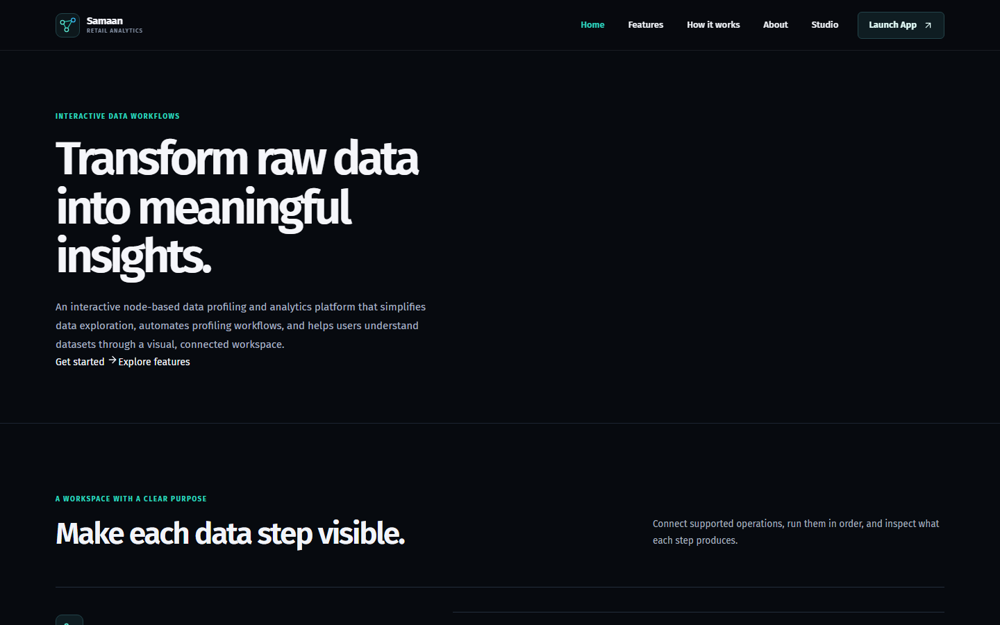
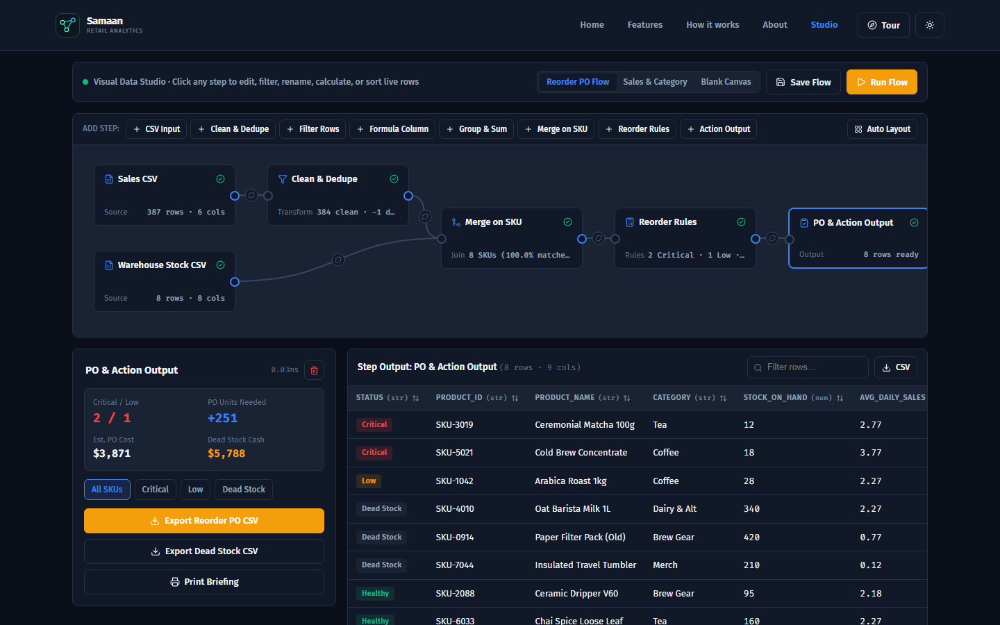
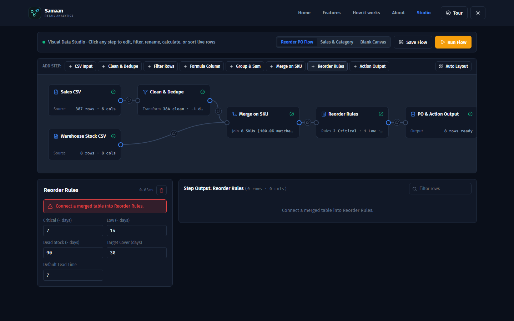

# Samaan — Node-Based Retail Sales & Inventory Studio

> **S.A.M.A.A.N.** — *Sales And Merchandise Automation & Analytics Network*  
> Visual Retail Analytics & Reorder Studio (`React 19 + Vite` · `FastAPI + Polars`)

Samaan replaces repetitive weekly Excel VLOOKUPs and manual stock checks with a repeatable **node-based visual pipeline**. Retail owners and analysts can drop raw POS Sales and Warehouse Stock spreadsheets into connected visual steps, inspect live row-by-row output at every node, tune reorder thresholds, and export ready-to-send **Reorder Purchase Orders (POs)** and **Dead Stock Clearance** lists in seconds.

---

## Visual Tour

| Landing Page & Product Overview | Visual Flow Studio (`/app`) |
| :---: | :---: |
|  |  |

| Node Inspector & Live Step Table | Reorder PO & Dead Stock Export |
| :---: | :---: |
|  |  |

---

## Why Samaan?

- **Zero "Black Box" Processing:** Click any node on the canvas to inspect its configuration alongside a live, sortable, searchable data table at that exact step.
- **Built for Weekly Re-Runs:** Save your flow and reorder rules in the browser (`localStorage`), swap in next week's CSV/Excel exports, and click **Run Flow**.
- **Retail Data Hygiene Out of the Box:** Automatically detects messy headers (`Qty Sold`, `Closing Stock Qty`, `SKU`, `Unit Cost`), removes duplicate transaction IDs, filters returns (`quantity <= 0`), and standardizes text casing.
- **Interactive Product Tour & Templates:** Launch immediately with **Reorder PO Flow**, **Sales & Category Summary**, or a **Blank Canvas**, guided by an interactive [ProductTour](ui/src/components/ProductTour.jsx).

---

## Visual Node Library (8 Steps)

| Node | Role | What It Does |
| :--- | :--- | :--- |
| **CSV Input** (`input_csv`) | Source | Uploads `.csv`, `.tsv`, `.xlsx`/`.xlsm`, or `.parquet`, auto-maps canonical retail headers, and lets you rename or hide columns. |
| **Clean & Dedupe** (`clean_sales`) | Transform | Deduplicates by key (`transaction_id`), excludes returns (`quantity <= 0`), normalizes text, fills missing values, and computes `net_sales`. |
| **Filter Rows** (`filter_rows`) | Transform | Multi-condition rule builder (**Match ALL / ANY**) supporting `=`, `!=`, `>`, `>=`, `<`, `<=`, `contains`, `is_null`, `not_null`. |
| **Formula Column** (`formula`) | Transform | Creates calculated numeric columns (`+ - * / ( )`) with clickable column chips and 1-click presets (`Line Revenue`, `Gross Profit`, `Margin %`). |
| **Group & Sum** (`summarize`) | Transform | Multi-column `GROUP BY` with `SUM`, `AVG`, `COUNT`, `COUNT_DISTINCT`, `PCT_TOTAL`, `MIN`, and `MAX`. |
| **Merge on SKU** (`merge_sku`) | Join | Joins 2 tables (`LEFT`, `INNER`, `FULL`) on selectable keys and optionally rolls up sales velocity (`units_sold`, `avg_daily_sales`) per SKU. |
| **Reorder Rules** (`reorder_rules`) | Rules | Classifies SKUs (`Critical`, `Low`, `Healthy`, `Dead Stock`), computes `days_of_cover`, `stock_value`, and `suggested_reorder_qty`. |
| **Action Output** (`action_output`) | Output | Displays PO summary metrics (**Critical/Low SKUs**, **PO Units Needed**, **Est. PO Cost**, **Dead Stock Cash**), filters by status, exports CSVs, and prints briefings. |

---

## Reorder & Inventory Classification Logic

Given each SKU's `stock_on_hand` and sales velocity (`avg_daily_sales = units_sold / observation_days`):

- **`days_of_cover`** = `stock_on_hand / avg_daily_sales`
- **Status Classification** (configurable defaults):
  - **Dead Stock:** `stock_on_hand > 0` and (`avg_daily_sales == 0` or `days_of_cover > 90`)
  - **Critical:** `avg_daily_sales > 0` and (`stock_on_hand <= 0` or `days_of_cover < 7`)
  - **Low:** `days_of_cover < 14` (or `stock_on_hand <= reorder_level` when defined)
  - **Healthy:** All other active SKUs
- **Suggested Reorder Qty** (for `Critical` & `Low` SKUs):
  - `max(1, ceil(avg_daily_sales * (target_cover_days + lead_time_days) - stock_on_hand))` *(default `target_cover_days = 30`, `default_lead_time_days = 7`)*

---

## Tech Stack & Project Structure

- **Frontend:** React 19, Vite 8, Lucide Icons, custom CSS design tokens (Light & Dark themes)
- **Backend:** FastAPI, Polars, Pydantic v2, OpenPyXL, SQLAlchemy (SQLite), Uvicorn
- **Testing & Quality:** Pytest, Ruff, ESLint

```text
Samaan/
├── backend/
│   ├── app/
│   │   ├── engine/
│   │   │   ├── flow_runner.py   # Topological DAG executor & 8 node handlers
│   │   │   └── ingestion.py     # CSV/Excel/Parquet parser & smart column mapper
│   │   ├── routers/flow.py      # /api/v1/flow/{upload,sample,run,export}
│   │   ├── schemas/flow.py      # FlowGraph, FlowNode, FlowRunResponse contracts
│   │   ├── db/                  # SQLite initialization & ORM models
│   │   └── main.py              # FastAPI entrypoint
│   ├── tests/test_flow.py       # End-to-end node & API test suite
│   └── requirements.txt
├── ui/
│   ├── src/
│   │   ├── components/
│   │   │   ├── FlowCanvas.jsx   # Drag-and-drop node canvas & port wiring
│   │   │   ├── NodeInspector.jsx# Step controls & sortable live table preview
│   │   │   ├── Navbar.jsx       # Landing & Studio navigation
│   │   │   └── ProductTour.jsx  # Interactive guided tour
│   │   ├── LandingPage.jsx      # Product landing page (/)
│   │   ├── App.jsx              # Studio shell & template switcher (/app)
│   │   └── api/client.js        # REST API client
│   └── package.json
├── deck/assets/                 # Prototype screenshots
└── deck_claims.md               # Source traceability for demo presentation
```

---

## Quick Start

### 1. Backend Setup (FastAPI + Polars)

```powershell
cd backend
python -m venv .venv
.\.venv\Scripts\python.exe -m pip install -r requirements.txt
.\.venv\Scripts\python.exe -m uvicorn app.main:app --reload --port 8000
```

The API runs at `http://127.0.0.1:8000` (interactive Swagger docs at `/docs`).

### 2. Frontend Setup (React + Vite)

```powershell
cd ui
npm install
npm run dev
```

Open `http://localhost:5173` for the landing page, or go directly to `http://localhost:5173/app` to launch the Visual Flow Studio.

---

## Running Tests & Linters

**Backend (`backend/`):**

```powershell
.\.venv\Scripts\python.exe -m ruff check --select F,I,B,UP app tests
.\.venv\Scripts\python.exe -m pytest tests\ -v
```

**Frontend (`ui/`):**

```powershell
npm run lint
npm run build
```

---

## API Endpoints

| Method | Endpoint | Description |
| :--- | :--- | :--- |
| `GET` | `/api/v1/health` | Health check (`{"status": "ok", "version": 1}`) |
| `POST` | `/api/v1/flow/upload` | Upload CSV/TSV/XLSX/Parquet and return column profiles + auto-mapped fields |
| `GET` | `/api/v1/flow/sample?template=reorder_po` | Seed sample data and run `reorder_po` or `margin_summary` flow |
| `POST` | `/api/v1/flow/run` | Execute a `FlowGraph` and return per-node row counts, stats, and 40-row previews |
| `POST` | `/api/v1/flow/export` | Download CSV for any node, `reorder` PO list, or `dead_stock` clearance list |

---

## Team

**Group 18 — Dept. of Computer Science & Engineering, Navrachana University**
- **Pawan Punjabi**
- **Vatsal Patel**
- **Dhanvin Patel**
